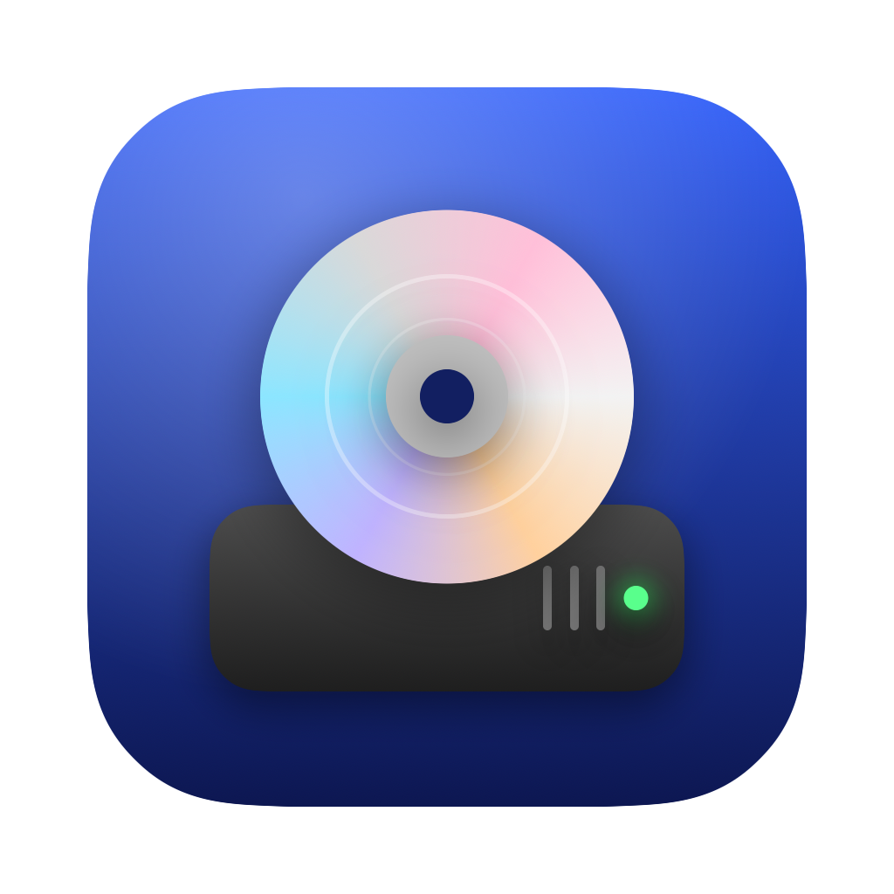

# `hdl_dump` and `hdl_dumb`

## Contents

- This fork: macOS app and HD Loader naming
- Intro
- Networking server
- Compilation
- Configuration and list file location
- Configuration
- New features

## This fork: macOS app and HD Loader naming

This fork adds **PS2 HDD Manager**, a native macOS app for preparing a PS2 internal hard drive
from a Mac (the job HDL Batch Installer / WinHIIP do on Windows), plus a few `hdl_dump` changes it needs.



### What the app does

- Lists **external physical drives only**; the Mac's internal/boot disk is never shown
- **Formats** a drive for PS2 (APA partition table, optional `+OPL` partition for Open PS2 Loader),
  after you type the disk name (e.g. `disk4`) to confirm
- **Installs games** from ISO, CUE/BIN, NRG, GI, IML or ZSO: drag & drop, names cleaned up
  automatically (`(USA)`, `[SLUS-…]` tags removed), CD/DVD detection, live progress with time left and
  speed, Stop button, free-space warning
- **Renames and deletes** games; delete really frees the space (via `pfsshell rmpart`), shows progress,
  and re-reads the drive to confirm
- **HD Loader compatible** naming (see below), with a one-click "Make Visible in HD Loader" for
  games installed with other naming
- **Duplicate detection by game ID** (e.g. `SLUS_200.62`): discs already on the drive or in the queue
  are skipped unless you choose *Install Anyway*; multi-disc games have a different ID per disc
- Asks for the administrator password **once per launch**; disk commands then go through a root shell
  that only the app can talk to

Games installed with this app show up in **Open PS2 Loader** (tested on a real PS2) and, with HD Loader
naming, in the original **HD Loader**.

### Build and run

```sh
brew install meson ninja
git clone --recursive https://github.com/Andron338/hdl-dump.git
cd hdl-dump
./macos/build_app.sh
open "macos/build/PS2 HDD Manager.app"
```

`pfsshell` (used for formatting and deleting) is included as a git submodule in `macos/vendor/pfsshell`;
run `git submodule update --init --recursive` if you cloned without `--recursive`.
More details, permissions and a disk-image test mode are in [`macos/README.md`](macos/README.md).

### Changes to `hdl_dump`

| Change | Command |
|---|---|
| Name partitions `PP.HDL.<name>` so the original HD Loader lists them (OPL and HDD-OSD see them too) | `hdl_dump inject_dvd hdd1: "Name" game.iso -hdl` |
| Convert an installed game to HD Loader naming; renames of such games keep it | `hdl_dump modify hdd1: "Name" -hdl` |
| Partition names hold only 24 characters of the name after `PP.HDL.`; colliding names get `~2`, `~3`… | automatic |
| Machine-readable game list including partition names (tab-separated, `#total` line at the end) | `hdl_dump hdl_toc hdd1: --tsv` |
| Accept ISO images whose file names lack the `;1` suffix (e.g. made with macOS `hdiutil`) | automatic |

On macOS, pass raw disk paths such as `/dev/rdisk4` as the device (`diskutil list` shows the number).

## Intro

The latest version, as well as documentation, can be found on the new official repository, <https://github.com/ps2homebrew/hdl-dump/>

_Me reads [w1zard0f07@yahoo.com](mailto:w1zard0f07@yahoo.com) and psx-scene forums every now and then.(c)_

Easy guide for installing games can be found here <http://web.archive.org/web/20120720230755/http://openps2loader.info/hdldump/howto.html>

## Networking server

_Update:_ Currently, OPL built-in NBD server is the preferred option.

_Deprecated:_
A UDP-based network server is available, based on the SMAP driver released by @sp193 <http://ichiba.geocities.jp/ysai187/PS2/smap.htm>. It is called `hdl_svr_093.elf` and is now part of the `hdl_dump` sources.

_**Note**: You might need to punch a hole in your firewall for incoming UDP from port 12345._

## Compilation

First of all, you have to update your PS2SDK.

Finally: You can run the shell script in the project folder: `mkrel.sh`. It will compile both GUI and CLI versions for Windows.

- **Linux**: Build and copy executable into a directory of your choice.

        make RELEASE=yes

    Advanced Linux build commands:

        make XC=win          # for Windows cross-compilation using mingw32
        make -C gui          # for WineLib compilation (currently not working)
        make -C gui XC=win   # for GUI cross-compilation using mingw32

- **Mac OS X** or **FreeBSD**: You'll need to have GNU make installed, then

        gmake RELEASE=yes IIN_OPTICAL_MMAP=no

    or

        make RELEASE=yes IIN_OPTICAL_MMAP=no

- **Windows**: You need to have MINGW32 installed;
    then use

        make RELEASE=yes
        make -C gui RELEASE=yes

    to compile command-line or GUI version.

## Configuration and list file location

You can place these files in the folder where is installed hdl_dump for making it portable.

- **Windows**:

    `%APPDATA%\hdl_dump.conf`
    `%APPDATA%\hdl_dump.list`

- **Linux**, **Mac OS X** and **FreeBSD**: (`~` is your home dir)

    `~/.hdl_dump.conf`
    `~/.hdl_dump.list`

## Configuration

- `disc_database_file` -- full path to your disc compatibility database file;

## New features

All new stuff can be used from HDD OSD, BB Navigator, or XMB from PSX DVR.

### ZSO support

hdl-dump supports zso compressed files. For using ZSO, you must keep original ISO (or cue/bin) files in the same folder and with the same name as ZSO compressed file. You should select original ISO (or cue/bin) and hdl-dump will check zso existence on installation. If ZSO file exists, it will install ZSO, if it does not exist it will install original ISO. Unfortunately, you need to keep original file for program to work.

### `inject_dvd`, `inject_cd`, `install` or `copy_hdd`.

This command will install games onto the hard disk.

_**Warning**: Be careful with `copy_hdd` - every HDLoader game will be given the same icon._

Optionally, you can place `boot.elf` (which is actually `miniopl.elf`) in the folder where `hdl_dump` is launched from.
You can also optionally include `list.ico` (`*.ico` from memory card) and `icon.sys` (`*.sys` from memory card), or you can write your own `icon.sys` file.

If you don't include an `*.ico`, the HDLoader logo is used. If you don't include `*.sys`, the default HDLoader icon settings are used..

Note: following options aren't supported by PSX1 (PSX DESR 1st generation).

`boot.elf`, `boot.kelf` - PS2 executable file in signed or unsigned form. [OPL-Launcher](https://github.com/ps2homebrew/OPL-Launcher) is a preferable option. Injection address - `0x111000`. Size limit - 2,026,464 bytes (thanks to kHn)

### `inject_mbr`

    hdl_dump inject_mbr /dev/sdb MBR.KELF

When you use this command and place the hard drive into your PlayStation 2 phat, it will launch the injected `MBR.KELF`. This option can be used as an entry point for PS2.

All HDD data will remain intact.

`MBR.KELF` injection address - `0x00404000` (for compatibility with PlayStation BB Navigator)

`MBR.KELF` size should be a maximum of `883200` bytes and have a valid header.

### `modify_header`

This command injects header attributes into an existing partition.

    hdl_dump.exe modify_header 192.168.0.10 PP.TEST

It can inject these files:

- `system.cnf`
- `icon.sys`
- `list.ico`
- `del.ico`
- `boot.kelf`
- `boot.elf`
- `boot.kirx`

Any one can be skipped. It first tries to inject `boot.kelf`, then if not found it will try to inject `boot.elf`.

Now `icon.sys` can be in any of 2 formats: Memory Card format or HDD format.

`del.ico` injection address: `0x041000` (If `del.ico` is used `list.ico` maximum size 260,096 bytes)

`boot.elf` (or `boot.kelf`) injection address - `0x111000`

`boot.elf` size limit - 2,026,464 bytes (thanks to kHn)

`boot.kelf` size limit - 3,076,096 bytes (if `boot.kirx` not used)

`boot.kelf` size limit - 2,031,616 bytes (if `boot.kirx` is used)

`boot.kirx` injection address - `0x301000`

`boot.kirx` size limit - 1,044,480 bytes

### HD Loader naming (`-hdl`)

`inject_cd`, `inject_dvd` and `modify` accept `-hdl`, which names the partition `PP.HDL.<game name>`
(the scheme the original HD Loader uses) instead of `PP.SLUS-12345..GAME_NAME`.
With `modify`, it converts an existing game; renaming a `PP.HDL.` game keeps that scheme.
If the 31-character partition name is already taken, `~2`, `~3`, … is appended.

### Machine-readable list (`hdl_toc --tsv`)

`hdl_toc <device> --tsv` prints one tab-separated line per game:
`type`, `size (KB)`, `compat flags`, `dma`, `startup`, `partition`, `name`,
followed by `#total <total MB> <used MB> <free MB>`.

### Hiding Games

You can hide games so that they are not visible in the HDD Browser by using the `-hide` switch with the `install`, `inject_cd`,
`inject_dvd`, or `modify` commands. A hidden game can be made visible again using the `-unhide` switch with the `modify` command. This is a necessary option for installing the games on PSX1 (1st DESR generation).

### Others

If you want to know more about these files (and their restrictions), you have to study the official SONY ps2sdk document called `hdd_rule_3.0.2.pdf`

There are also some undocumented features like this:

- If you want to inject `boot.kelf` (or `boot.elf`), you have to change `BOOT2` in `system.cnf`.

        BOOT2 = PATINFO

    If you need to erase `boot.elf` from the PATINFO you have to place zero-sized `boot.kelf` or elf in program folder.
    \_**Note**: PSX1 (DESR 1st generation) doesn't support the PATINFO parameter.

- If you want to launch KELF from the PFS partition you have to change `BOOT2` in `system.cnf`

        BOOT2 = pfs:/EXECUTE.KELF

    where `EXECUTE.KELF` - is the path to KELF that is placed into the partition. Changedable.

- If you want to inject kirx into the partition you have to add a line into `system.cnf`

        IOPRP = PATINFO

    Don't ask about kirx - I don't know where that is used.
    \_**Note**: PSX1 (DESR 1st generation) doesn't support the IOPRP parameter.

- If you don't want to boot from HDD OSD you have to add such a line into system.cnf

        BOOT2 = NOBOOT

Happy gaming.
